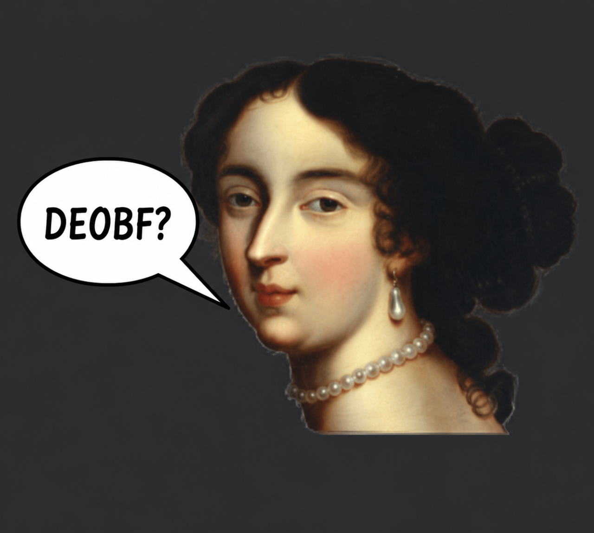

<p align="center">
  
  <br><br>
  <a href="https://discord.gg/WYjATa6BrU">
    
  </a>
  
  
  
</p>

<p align="center">
  <a href="https://discord.gg/WYjATa6BrU">https://discord.gg/WYjATa6BrU</a>
</p>

<p align="center">
  
</p>

<p align="center">
  
  
  
  
</p>

<p align="center">
  
</p>

## Why?
- The anticheat is horrible, a lot of servers paid for it and almost every single one changed to another anticheat because this crap doesn't even have an attempt of prediction like Vulcan, the development is pretty inactive and it looks like the devs of Verus never played minecraft in their entire life.

<p align="center">
  
</p>

## How to build

### Prerequisites
- **Java Development Kit**: JDK 17 (the Gradle wrapper 8.14.3 does not run on newer JDKs)

### Building OpenVerus

Run from this folder:

```powershell
$env:JAVA_HOME = "C:\Program Files\Java\jdk-17"

.\gradlew.bat prepareIde
.\gradlew.bat clean build
```

The build also compiles every NMS adapter listed in `platforms/versions.txt` (`v1_7_R4` through `v1_20_R3`).

Generated `build/libs/`:
- `OpenVerus-b3952-java17.jar`
- `OpenVerus-b3952-plain.jar`
- `OpenVerus-b3952-sources.jar`
